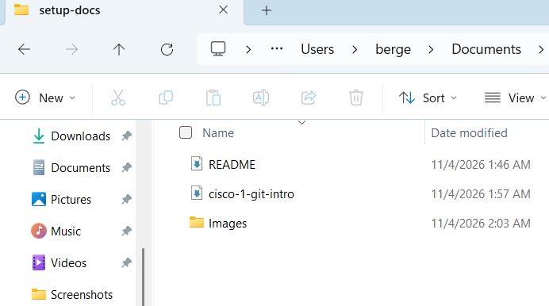

# My First Git Lab

This is my first document stored in Git

## Things I Learned

- Git tracks changes to files.
- GitHub stores my repository online.
- **SSH Keys** keep my account secure.
- up arrow reveals past commands
- enable moves you into priv. exec. mode

# Notes

## Basic configuration for a switch
- enter <b>enable</b> to enter privilege exec. mode
- Enter conf t to enter global configuration mode
- enter: hostname ex:S1 (make sure your commands and switches match the source text letter-for-letter.)

## Configure the console and encrypted privileged EXEC mode passwords
### Console
- in global configuration mode enter # line console 0
- then enter # password ex:cisco
- then enter # login
### privilege exec mode passwords
- enter # enable secret ex:class
-encrypt all passwords with # service password-encryption
### setting up a banner
- banner motd "example banner"
### Save configuration file to NYRAM.
- copy run start
### Configure the switch management interface.
- (in configuration mode) enter # interface vlan1
- enter ip address ex: 192.168.1.253 255.255.255.0
- No shutdown
- password for VTY 0.  enter # line vty 0 15. ex:ASw-2(config-line)#password example password.
### domain name problem
- no ip domain-lookup
### tera term
- serial, com5
- control panel
- ethernet properties
- ipv4

